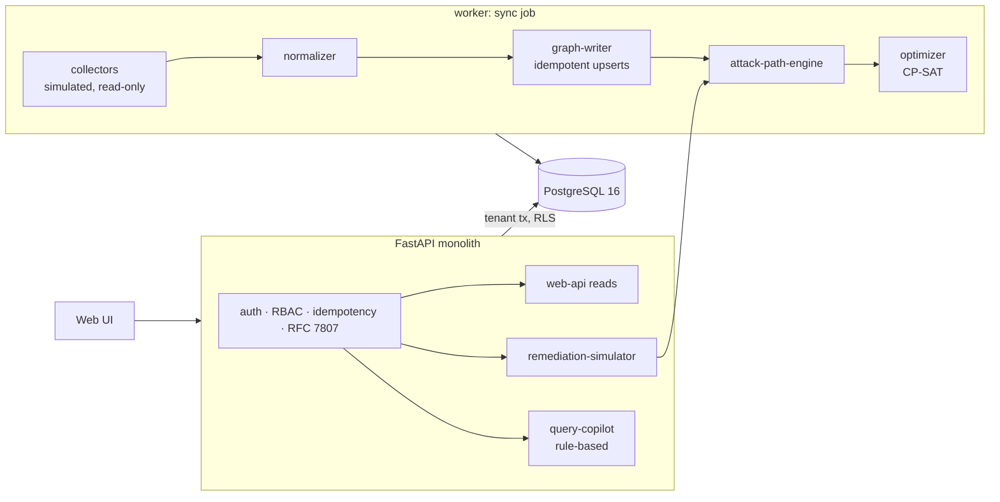

# Attack-Path & Exposure Management Platform

Security teams get thousands of vulnerability findings and no idea which ones matter. This platform builds one graph of workloads,
identities, secrets and data stores across AWS, Azure and Entra ID, finds the routes an attacker could take from the internet to
business-critical data, and ranks fixes by how much path risk they remove instead of by severity score.

Built from blueprint 2 of an "Enterprise SaaS + AI" build book as a **vertical slice**: the demo scenario end to end on a synthetic
estate, with the platform parts real and the rest listed under [Not built](#not-built-and-why).

**Everything is synthetic: invented assets, identities and CVE ids (`CVE-2099-…`). The collectors are simulators; no cloud account is touched.
This is a defensive exposure-analysis tool: it reads configuration and never exploits anything.**

## Run it

```bash
docker compose up --build        # migrates, seeds two tenants, serves http://localhost:8102/ui/
docker compose run --rm test     # 21 tests against a throwaway database
```

Open http://localhost:8102/ui/ and press **Run all steps**, or `make bootstrap demo` from a terminal. API docs at `/docs`.
Demo tokens (local only): `acme-admin-demo`, `acme-analyst-demo`.

## The demo, step by step

1. Register AWS, Azure and Entra collectors and run a sync job: 8,675 assets, 4,453 identities, 23,737 relationships, 6,915 findings. 6 of 15 crown-jewel data stores are reachable; 9 attack paths.
2. Open `orders-db` (criticality 5, no findings of its own): 4 paths lead to it. The top three are drawn as chains.
3. The top path explained: public `web-frontend` with a known-exploited CVE → its instance role → `sts:AssumeRole` into `deploy-automation` → reads secret `prod/db/orders-master` → the database. Two plain-language questions are answered from graph edges only.
4. The optimizer picks two fixes for this database: remove one secret-read permission and patch one CVE. Re-searching the changed graph: risk 85.1 → 0.
5. Patching the two highest-CVSS findings in the estate instead removes 0%. Estate-wide, eight path-chosen fixes remove 100% of crown-jewel risk; eight by CVSS remove 0%.
6. A ticket with the path evidence goes to the owning team. Both fixes are marked done, the next collection makes a new snapshot, and `GET /v1/changes` lists the four removed paths.

## Architecture



| Concern | How it is done |
|---|---|
| One model for three vendors | `ap/normalize.py` maps each vendor's objects to nodes and typed relationships keyed by vendor id, so an Azure Key Vault secret that unlocks an AWS role is one edge. Dangling references are dropped and counted. |
| Search | Attack graph of exploitable steps only; k-shortest simple paths by `-log(probability)`, pruned to nodes that are both internet-reachable and ancestors of the target; replicas in one autoscaling group collapse into one finding. |
| Scoring | Path probability = product of step probabilities; exploit steps use the easiest open CVE (CVSS, exploit maturity, known-exploited flag). Stated priors, not a fitted model. |
| Remediation | Exact max-coverage over enumerated paths (OR-Tools CP-SAT), then verified by re-searching, repeating if cutting the top paths revealed new ones. |
| Tenant isolation | Row-level security via a per-transaction role and tenant id. A tenant cannot name another tenant's asset, path or remediation (404), and remediation ids are validated against its own graph. |
| Async, idempotency, audit | Postgres job queue with retries and a dead-letter state; `Idempotency-Key` on writes; upserts by `(tenant, external_id)`; append-only, hash-chained audit log. |

## Data model

`migrations/002_exposure.sql` follows the blueprint (integrations, assets, vulnerabilities, asset_vulnerabilities, identities,
graph_snapshots, attack_paths, remediations) plus a versioned `relationships` table marked `(+)`.

## API

| Method | Endpoint | Purpose |
|---|---|---|
| POST | `/v1/integrations` | Register a source (credentials stored encrypted) |
| POST | `/v1/syncs` | 202 + job: collect, normalize, write, search |
| GET | `/v1/summary` | North-star metrics and crown jewels |
| GET | `/v1/assets?name=` · `/v1/assets/{id}` | Asset details and exposure context |
| GET | `/v1/attack-paths?target={asset}` | Ranked paths |
| POST | `/v1/simulations` | Hypothetical fixes (given, or chosen by the optimizer) and the risk delta, with the CVSS-first baseline |
| GET | `/v1/remediations` | Backlog ranked by verified risk reduction per effort |
| POST | `/v1/remediations/{id}/ticket` · `{id}:complete` | Ticket with path evidence · mark done |
| POST | `/v1/query` | Grounded question over the graph |
| GET | `/v1/changes` | Paths added or removed between the last two snapshots |

Contract: [`docs/openapi.json`](docs/openapi.json). Errors are `application/problem+json`.

## Measured

[`docs/evaluation.md`](docs/evaluation.md) (`python -m ap.evaluate`) and [`docs/performance.md`](docs/performance.md).

| Question | Result |
|---|---|
| Planted attack chains recovered | 9 of 9, node for node |
| Risk left after 4 fixes: optimizer / CVSS-first / internet-facing known-exploited first | 29% / 100% / 92% |
| Risk left after 8 fixes | 0% / 100% / 64% |
| Full-estate search, pruned | about 30 ms |
| Read endpoints at 8 clients | 492 req/s, p95 21 ms |
| Simulation endpoint at 8 clients | 3.3 req/s, p95 3.0 s (single process; see performance.md) |

The gap to CVSS-first is by construction: the estate was generated so that high-severity findings mostly sit on machines that lead
nowhere critical (9 of 6,915 findings are on a path). That is the product's premise, not a discovery.

## The hardest tradeoff

The blueprint puts the graph in Neo4j. Here edges are rows in Postgres and the search runs in memory with networkx. At this size
a whole-estate analysis takes tens of milliseconds, the graph is rebuilt once per snapshot, and one database means one transaction
covers the graph, the snapshot and the audit record. The cost: the graph must fit in the API process's memory (fine for tens of
thousands of nodes, not for tens of millions), and there is no ad-hoc graph query language for analysts. The canonical model does not
depend on the store, so moving the edges to a graph database later changes `ap/store.py` only.

## Threat model (summary)

| Threat | Mitigation here | Gap |
|---|---|---|
| Cross-tenant graph traversal | RLS per transaction; graph cache keyed by tenant; ids validated against the caller's own graph | Cache lives in process memory |
| The product itself becoming an attack tool | Collectors are read-only by design; output is configuration analysis, no exploit content | Real collectors and their scoped cloud roles are not built |
| Injection through the question box | No query language reaches a store: fixed patterns, names looked up in a dictionary, everything else refused | Only five question shapes |
| Stolen cloud credentials | Encrypted at rest (Fernet), never returned by the API | Key from an env var, no KMS, no rotation |
| Tampering with what was decided | Append-only, hash-chained audit of syncs, tickets and completions | No external anchor |

## Not built, and why

- **Real cloud collectors**: needs real accounts; the simulator emits vendor-shaped JSON so the normalizer is exercised.
- **Neo4j**: see the tradeoff above. **Kafka, Redis, OpenTelemetry, Grafana, Terraform, CI**: not needed to prove the slice; no cloud account used.
- **Community detection**: Louvain was tried on the access graph and flagged nothing useful, because this estate's applications are separate components by construction. Removed instead of shipping a feature that shows nothing.
- **LLM query interface**: the question box is rule-based so that every answer is provably made of graph edges.
- **Calibrated scoring, drift monitoring, SSO, webhooks, a Next.js front end**: not started.
- **Scale note**: the blueprint asks for 10k assets and 5k identities; the generator produces 8,675 and 4,453 at scale 1.0.

## Commercial sketch

Buyer: enterprise security teams and MSSPs. Pricing shape from the blueprint: annual contract by protected assets or cloud accounts,
a multi-tenant MSSP tier, simulation as a premium module. The UI's "What is it worth?" panel compares the cost of the path-first
fixes with patching everything; hours and rates are labelled assumptions.

## Layout

```
core/        platform kit: db + RLS, jobs, audit chain, HTTP (auth, problems, idempotency, metrics), scenario runner, load test
ap/          estate (simulated collectors), normalize, store, graph (search, scoring, simulate, optimize), query, api, seed, evaluate
migrations/  forward-only SQL          web/   UI, scenario.json, demo.json (recorded run)
tests/       21 tests                  docs/  evaluation.md, performance.md, openapi.json
```
